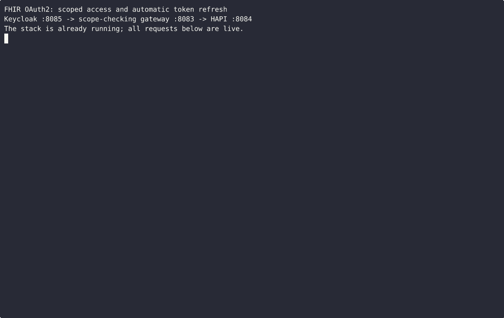

# FHIR + MCP: OAuth2 Client Credentials and Scope Enforcement

A small, runnable demo of how an AI agent's MCP server gets a token for a FHIR
server, and how the token (not the prompt) limits what the agent can read.



Three containers: Keycloak (authorization server), HAPI FHIR, and a small
Python gateway that validates JWTs against Keycloak's JWKS and checks
SMART-style `system/` scopes.

## Prerequisites

- Docker and Docker Compose
- Python 3.12+

## Run

```bash
# 1. Python dependencies
python3 -m venv .venv
source .venv/bin/activate
pip install -r requirements.txt

# 2. Start the stack and wait for Keycloak to be healthy (~30-60s)
docker compose up -d
docker compose ps        # keycloak should show "healthy"

# 3. Seed HAPI with synthetic data (direct to HAPI on :8084, no auth)
python seed.py

# 4. Run the three cases
python demo.py
```

## What the demo shows

1. **Valid token**: client credentials grant with `system-Observation.rs` scope,
   Observation search returns 200.
2. **Wrong scope**: the same client searches Patients, the gateway returns 403.
3. **Token near expiry**: the token lives 60s; `TokenClient` refreshes it inside
   a 30s cache margin, before it expires, and the next call returns 200.

`demo.py` drives `TokenClient` and the gateway directly. `mcp_server.py`
exposes the same calls as an MCP tool (`search_observations`) over STDIO.

## Scope naming

Keycloak does not allow `/` in client scope names. The demo uses
`system-Observation.rs` (dash) in Keycloak. The gateway normalizes this to
`system/Observation.rs` when checking. A SMART-native FHIR server would use
the canonical `/` format directly.

## Ports

| Service  | Port | Purpose                         |
|----------|------|---------------------------------|
| Gateway  | 8083 | FHIR requests (scope-enforced)  |
| HAPI     | 8084 | Direct FHIR (no auth, for seed) |
| Keycloak | 8085 | Token endpoint, JWKS (admin/admin) |

## Credentials are demo-only

The client secret `demo-secret-not-for-production` and the Keycloak
`admin/admin` login exist only for this local stack. All ports bind to
`127.0.0.1`. Never reuse these values, and in a real deployment load
credentials from the environment or a secret manager.

## Recording

`recording/record-video.sh` records a live run with asciinema and renders a
GIF with agg. See [recording/README.md](recording/README.md).

## Related

- LangCare FHIR MCP server, generic OAuth2 client credentials:
  [PR #10](https://github.com/langcare/langcare-mcp-fhir/pull/10) (under review)

## Cleanup

```bash
docker compose down -v
```

## License

MIT
